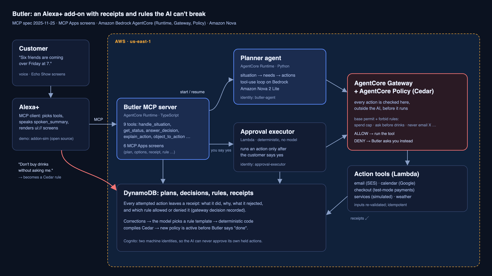

# Butler

**An Alexa+ add-on that acts on your behalf, keeps a receipt for every action, and turns your corrections into rules it cannot break.**

Built for the [Build, Ship, Shape: Amazon Developer Hackathon](https://amazonappdev2026.devpost.com/): Alexa+ track, plus the AWS Builder and Open Source mini challenges.

- **Demo video:** _YouTube link added at submission_ (2:44, recorded against the deployed AWS stack)
- **Simulator (open source):** [`addon-sim/`](addon-sim/), also published on its own: https://github.com/pauleke65/addon-sim



## What it does

You describe a situation, not a command: *"Six friends from the dinner crew are coming over Friday at 7."* Butler works out what that needs and handles it:
- it sends the invites and puts the dinner on your calendar;
- it compares drink options and buys the one that arrives in time, within your spending limit;
- it asks you which cleaner to book.

Every action leaves a **receipt**: what it did, why, what it rejected, and which rule allowed it. When you object (*"don't buy drinks without asking me"*), Butler turns that into a **rule enforced outside the AI model**. Next time it tries to buy drinks, the gateway blocks the call and Butler asks you instead.

## Why it's built this way

| Idea | How |
|---|---|
| Rules the AI can't talk its way around | Every action goes through **Amazon Bedrock AgentCore Gateway**, where **AgentCore Policy** evaluates Cedar rules before the tool runs. The model never sees or writes the policy. |
| The AI can't approve itself | Two machine identities. "Ask first" rules block only the agent's identity. When you say yes, a separate deterministic **approval executor** (no model) runs the action under its own identity. `never` rules block both. |
| Corrections become rules safely | The model only picks a rule template and fills its parameters. Deterministic code validates them, compiles Cedar, activates the policy, and waits until it's enforced before saying "done". |
| Fail closed | Cedar skips a rule that errors, so a missing or mistyped field could let an action through. Every rule is guarded, inputs are type-checked before the call, and every tool re-validates its own inputs (e.g. checkout recomputes the total). |
| Made for Alexa+ | Turn-based design (Butler never interrupts), one tool per intent, a `spoken_summary` that works voice-only, and screens that follow Amazon's four Alexa+ layouts (List, Carousel, Card; Map unused). |

## Where to look in the code

| What | Where |
|---|---|
| **MCP server entry point** (Streamable HTTP, negotiates MCP **2025-11-25**) | [`server/src/index.ts`](server/src/index.ts) → [`server/src/server.ts`](server/src/server.ts) |
| The 9 Alexa-facing tools | [`server/src/tools/`](server/src/tools/) |
| MCP Apps screens (`ui://butler/*`) | [`server/ui/src/views/`](server/ui/src/views/) |
| Planner agent (Bedrock tool-use loop) and rule drafting | [`agent/butler_agent/`](agent/butler_agent/) |
| Rule templates, Cedar compiler, policy service | [`libs/butler_rules/`](libs/butler_rules/), compiled policies in [`policies/golden/`](policies/golden/) |
| Action wrapper and receipts | [`libs/butler_actions/butler_actions/wrapper.py`](libs/butler_actions/butler_actions/wrapper.py) |
| Approval executor | [`executor/`](executor/) |
| Action tools behind the gateway | [`actions/butler_action_handlers/`](actions/butler_action_handlers/) |
| AWS infrastructure (CDK: AgentCore Runtime, Gateway, Policy engine, Cognito, DynamoDB, Lambda) | [`infra/`](infra/) |
| Spec, handoff and as-built notes | [`SPEC.md`](SPEC.md), [`handoff/`](handoff/) |

## Run it locally (no AWS account needed)

```bash
make install                      # pnpm install + uv sync (Python 3.12)
scripts/stack.sh start            # local DynamoDB, gateway emulator (real Cedar), executor, agent, MCP server
pnpm --dir addon-sim dev          # simulator on http://localhost:3000
```

Then type or say *"Tell Butler six friends from the dinner crew are coming over Friday at 7."*

The local gateway emulator evaluates the **same compiled Cedar policies** with the open-source Cedar engine, so the rules behave as they do on AgentCore Policy. Other commands:

```bash
make test                                          # all Python + TypeScript tests
pnpm --dir addon-sim play scripts/butler-golden.yaml --url http://localhost:8000/mcp --token local-sim-token
uv run python -m butler_local.seed --reset         # reset the demo between runs
```

Model-backed steps (planner, rule drafting, fast needs pass) are written for **Amazon Nova 2 Lite** via Bedrock (`LLM_MODE=bedrock`). Each also has a deterministic offline implementation (`LLM_MODE=offline`, the default) so tests and demos run anywhere. Our new AWS account still has zero Bedrock quota, so the deployed stack and the demo video run the offline implementations; see [`docs/bedrock-setup.md`](docs/bedrock-setup.md).

## Real vs simulated

| Part | Status |
|---|---|
| MCP server, screens, planner, rules, receipts, approval flow | Real |
| Policy enforcement | Real: AgentCore Policy on the deployed stack (the demo video shows a real gateway DENY); the open-source Cedar engine locally |
| Email (Amazon SES), calendar (Google Calendar) | Adapters implemented and tested; the demo and the deployed stack use test stand-ins |
| Payments | Test-mode adapter implemented and tested; the demo uses a test stand-in, nothing is charged |
| Product catalogue, cleaners and other service providers | **Simulated** (labelled "Simulated" on every screen) |
| Alexa+ itself | The official simulator isn't open to hackathon participants, so the demo runs in [`addon-sim`](addon-sim/), an open-source host that follows Amazon's published Alexa+ MCP design guide |

## Licence
MIT. The simulator is a generic tool and is not affiliated with Amazon.
