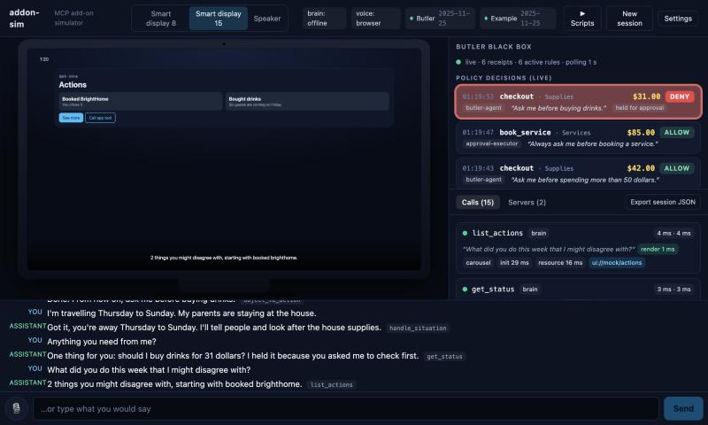
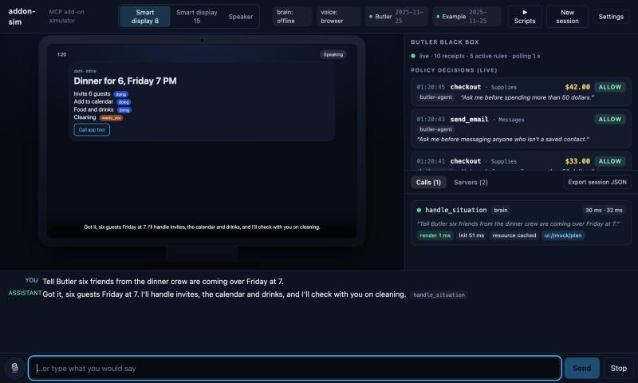
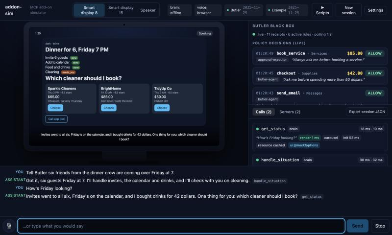
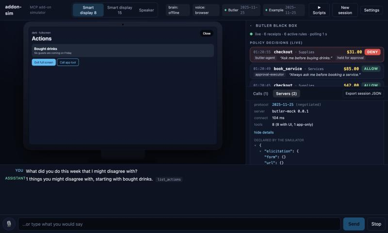
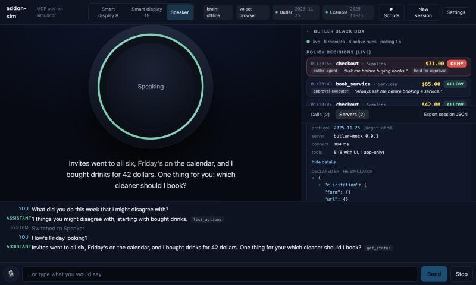
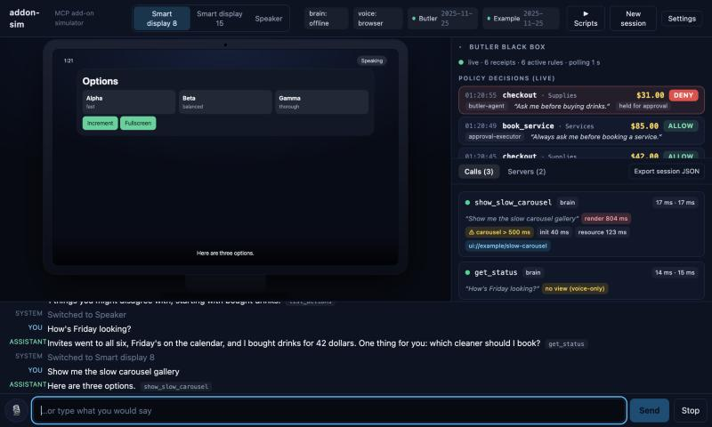
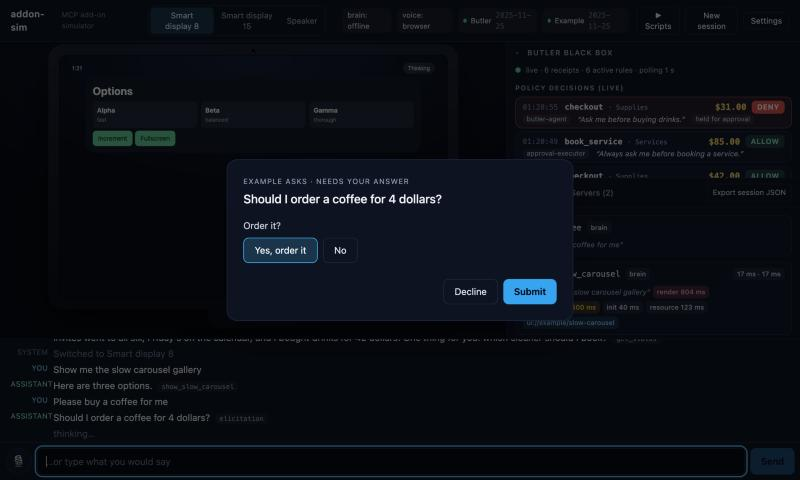
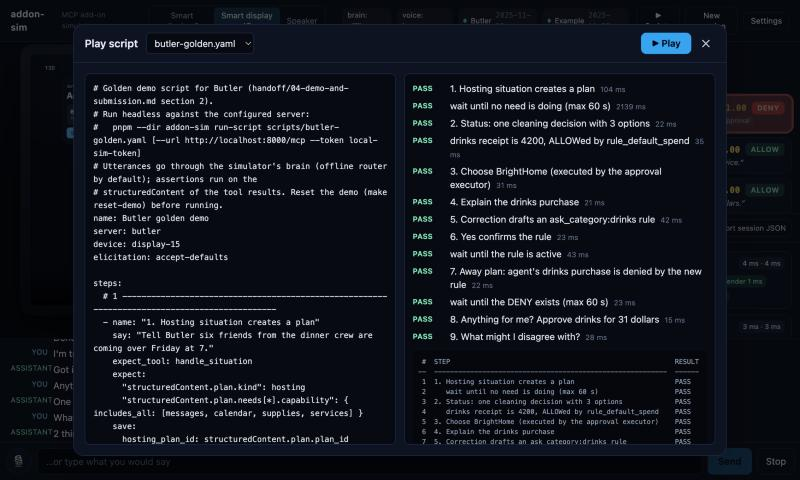

# addon-sim

An open-source simulator for **voice assistants that host MCP add-ons**. Point it at any MCP server and it behaves like the assistant side of the conversation: it picks tools from your utterances, calls them over Streamable HTTP, renders [MCP Apps](https://github.com/modelcontextprotocol/ext-apps) views in a sandboxed iframe on a second origin, speaks the reply, and shows you everything that happened.

> **Not affiliated with, endorsed by, or sponsored by Amazon.** "Alexa" and related marks belong to their owners. addon-sim is an independent developer tool that follows the public MCP and MCP Apps specifications. Device frames are generic and carry no manufacturer branding.



## Why

Assistants such as Alexa+ can now call third-party tools over MCP, but the developer-facing simulator is gated, so you cannot see how your add-on's tool descriptions get routed, what your views look like on a 1280x800 or 1920x1080 screen, whether your carousel meets the 500 ms first-render budget, or what your server does when the platform declares elicitation. addon-sim gives you that loop on a laptop with no accounts.

## What you get

| Area | What it does |
|---|---|
| **MCP client** | Streamable HTTP, bearer or OAuth2 client-credentials auth (Cognito style), declares `elicitation` (form + url) and the MCP Apps UI extension, protocol version negotiation shown in the inspector, reconnect on lost sessions. Multiple servers at once. |
| **Brain** | A tool-use loop that chooses tools from names and descriptions only (no add-on specific code). `LLM_MODE=offline` is a deterministic keyword router for tests and rehearsals; `LLM_MODE=bedrock` uses Amazon Bedrock Converse. Conversation memory, "yes" bound to the last pending confirmation, clarification on `AMBIGUOUS_REFERENCE`. |
| **MCP Apps host** | `AppBridge` + sandbox proxy iframe on another origin (`:3001`), CSP from `_meta.ui.csp`, tool input then tool result, view-initiated `tools/call` forwarded to the right server, inline and fullscreen display modes, teardown on replacement, per-session resource cache, generic fallback card when a result has no UI. |
| **Voice** | Hold Space (or the mic button) to talk with the Web Speech API, or type. Replies are spoken with Amazon Polly (neural) and fall back to the browser's `speechSynthesis` automatically. Speaking again barges in. Everything is captioned. |
| **Devices** | "Smart display 8" (1280x800), "Smart display 15" (1920x1080), "Speaker" (voice-only, light ring, never renders views). Switch mid-conversation. |
| **Elicitation** | Form requests become buttons plus a spoken question; URL requests open a consent modal. |
| **Inspector** | Per call: tool, args, result JSON (collapsible), TTFB and total time, view first-render time with a warning when a carousel exceeds 500 ms, errors highlighted, negotiated protocol and capabilities, export the session as JSON. |
| **Panels** | A tiny plugin API (`{ id, title, mount(el, ctx) }`) loaded by URL. The repo's `sim-panel/` is one such plugin (a live "black box" feed for the Butler add-on). |
| **Scripted runner** | YAML conversation scripts (`say`, `expect_tool`, `expect`, `wait_until`, `device`, `call`) run headless from the CLI or in the UI. |

### Screenshots

| | |
|---|---|
|  |  |
|  |  |
|  |  |

## Quick start (about 10 minutes)

Requires Node 20+ and pnpm. Inside this directory:

```bash
pnpm install --ignore-workspace      # standalone package (also fine without the flag outside a monorepo)
pnpm dev                             # host on :3000, sandbox proxy on :3001
```

Open <http://localhost:3000>. By default it connects to `http://localhost:8000/mcp` with the bearer token `local-sim-token` (the Butler add-on). To try it with nothing else running, start the bundled example MCP Apps server in a second terminal and point the simulator at it:

```bash
pnpm example-apps-server             # http://localhost:8120/mcp (no auth): a counter view, a slow carousel, elicitation
SIM_SERVERS='[{"id":"example","name":"Example","url":"http://localhost:8120/mcp","auth":{"type":"none"}}]' pnpm dev
```

Then say or type: "show me the counter", "show me the slow carousel gallery" (watch the inspector flag it), "please buy a coffee for me" (elicitation form), "pay the invoice online" (URL elicitation modal).

### Using a server from the ext-apps examples

The [ext-apps repository](https://github.com/modelcontextprotocol/ext-apps) ships example servers. Start one on a free port (their default `:3001` clashes with the sandbox; either change theirs or set `SANDBOX_PORT=3011` for addon-sim), then add it in **Settings** or via `SIM_SERVERS`:

```bash
SANDBOX_PORT=3011 SIM_SERVERS='[{"id":"ext","name":"ext-apps example","url":"http://localhost:3001/mcp","auth":{"type":"none"}}]' pnpm dev
```

## Connecting any MCP server

Open **Settings** (top right) and add a server:

* **URL** of a Streamable HTTP endpoint (for example `https://mcp.example.com/mcp`).
* **Auth**: `none`, `bearer token`, or `client credentials` (token URL, client id, secret, optional scope; the token is fetched and refreshed automatically).
* **Invocation name**: the spoken name of the add-on ("Butler"). "Ask Butler to ..." and "Tell Butler ..." route to that server, and the name is stripped before tool arguments are filled.

Or set defaults with environment variables:

```bash
SIM_SERVERS='[{"id":"my","name":"My add-on","url":"http://localhost:9000/mcp","auth":{"type":"bearer","token":"..."},"invocationName":"My Add-on"}]'
```

How the simulator treats your server:

* **Tool selection uses only names, descriptions and JSON schemas.** Write descriptions as "Use when the customer ... Returns ...", exactly as a real assistant would need them.
* Tools whose `_meta.ui.visibility` is `["app"]` are hidden from the brain but callable by your views.
* UI is taken from `_meta.ui.resourceUri` on the **result** (preferred) or the **tool definition**. The `ui://` resource is read once per session and cached.
* If the result has `structuredContent.spoken_summary` it is what gets spoken; otherwise the first text block, then `structuredContent.error.message_spoken`.
* Conventions the offline router understands (all optional): `structuredContent.needs_confirmation: true` makes a following "yes" re-issue the same call with `confirm: true`; a single `pending_decisions[0].kind === "approve_action"` makes "yes"/"no" call a tool that has a `choice` parameter; `error.code: "AMBIGUOUS_REFERENCE"` with `candidates: [{id,label}]` produces a clarifying question.

### LLM modes

| `LLM_MODE` | Brain | TTS |
|---|---|---|
| `offline` (default) | Deterministic keyword/regex router. No network, no AWS. | Browser `speechSynthesis` |
| `bedrock` | Bedrock Converse tool-use loop (`BEDROCK_MODEL_BRAIN`, default `us.amazon.nova-2-lite-v1:0`, region `AWS_REGION` or `us-east-1`) using your default AWS credential chain. | Amazon Polly neural voice (`POLLY_VOICE_ID`, default `Joanna`), falling back to the browser voice on any failure |

```bash
LLM_MODE=bedrock pnpm dev
```

## Scripted conversations

```yaml
server: butler            # server id from Settings / SIM_SERVERS
device: display-15
steps:
  - say: "Tell Butler six friends from the dinner crew are coming over Friday at 7."
    expect_tool: handle_situation
    expect:
      structuredContent.plan.kind: hosting
      structuredContent.plan.needs[*].capability: { includes_all: [messages, calendar, supplies, services] }
    save: { plan_id: structuredContent.plan.plan_id }
  - wait_until: { tool: get_plan, args: { plan_id: "${plan_id}" }, path: "plan.needs[*].status", none_equal: doing, timeout_s: 60 }
  - say: "How's Friday looking?"
    expect_spoken: ["dollars"]
```

Steps: `say`, `wait_until`, `device`, `call` (direct tool call), `sleep_s`. Assertions: `expect_tool`, `expect` (paths into the tool result, rooted at `structuredContent` unless they start with `content`, `isError`, `_meta`, `args`), `expect_args`, `expect_spoken`. Operators: a plain value, or `equals`, `contains`, `matches`, `exists`, `gt/gte/lt/lte`, `one_of`, `includes_all`, `any_equal`, `none_equal`, `all_equal`, `length`. Wildcards (`[*]`) fan out. `${var}` interpolates values captured with `save`.

```bash
pnpm play scripts/butler-golden.yaml                       # headless, offline brain, default server
pnpm play scripts/butler-golden.yaml --url http://localhost:8110/mcp --token local-sim-token
pnpm play scripts/example-apps.yaml --url http://localhost:8120/mcp
```

Prints a PASS/FAIL table and exits non-zero on failure (`--bail`, `--json`, `--llm bedrock` are available). In the UI, **Scripts** plays the same file with views rendering and voice speaking, for rehearsals.



## Panel plugins

A panel is an ES module that exports `{ id, title, mount(el, ctx) }` (as `default`, `panel` or `panels`). List module URLs in `PANEL_URLS` (comma separated) or in Settings, and they are loaded at runtime with `import()`:

```ts
export default {
  id: "my-panel",
  title: "My panel",
  mount(el, ctx) {
    el.textContent = "hello";
    const off = ctx.onEvent((e) => console.log(e.type, e.tool));      // tool calls, utterances, device changes
    return () => off();                                                // optional cleanup
  },
};
```

`ctx` gives you `env` (`DEBUG_API_URL`, `DEBUG_API_TOKEN` and any `PANEL_ENV_*` variable), `sessionId`, `onEvent`, and `fetch(url, { headers })`, which goes through an allow-listed same-origin proxy so local APIs need no CORS (set `PANEL_PROXY_ALLOW=http://localhost:8085,...`; the origin of `DEBUG_API_URL` is always allowed). The full type contract is in [`src/lib/panels/types.ts`](src/lib/panels/types.ts).

The Butler "Black Box" panel lives in [`../sim-panel`](../sim-panel) (not part of addon-sim): `pnpm --dir ../sim-panel build && pnpm --dir ../sim-panel serve`, then `PANEL_URLS=http://localhost:3002/panel.js pnpm dev`.

## How it fits together

```
 browser (:3000)                                   server (Next.js route handlers)                 your MCP server(s)
 ┌──────────────────────────┐   POST /api/turn     ┌───────────────────────────────┐   Streamable    ┌──────────────┐
 │ device stage + transcript│ ───────────────────▶ │ Brain (offline | bedrock)     │ ──────HTTP────▶ │ tools/call   │
 │ inspector + panels       │ ◀─── NDJSON events ─ │ McpClientManager (SDK client) │ ◀───────────────│ resources    │
 │ AppBridge ◀─postMessage─▶│   /api/mcp/call      │ elicitation hub, TTS (Polly)  │                 └──────────────┘
 │   sandbox iframe (:3001) │   /api/mcp/resource  └───────────────────────────────┘
 │     └ view iframe        │
 └──────────────────────────┘
```

* `src/lib/mcp` MCP client manager and tool helpers. `src/lib/brain` the `Brain` interface, offline router, Bedrock loop, prompt. `src/lib/apps-host` the AppBridge host and CSP. `src/lib/voice` speech in/out. `src/lib/runner` YAML runner. `src/lib/panels` plugin API. `src/components` the UI. `sandbox/` the proxy server and page.
* Both brains implement one interface; the only place that branches on `LLM_MODE` is `src/lib/brain/factory.ts`.

## Development

```bash
pnpm test           # vitest: client, brain (incl. a fake Bedrock client), runner, host CSP/sandbox, API routes
pnpm typecheck
pnpm mock-server    # a stateful stand-in for the Butler add-on on :8110 (used by the tests and the golden script)
pnpm build          # production build of the host
```

Bedrock calls only happen in `LLM_MODE=bedrock`; no test touches the network or AWS.

## Limitations

* **Not the real thing.** Real assistants differ in routing, latency budgets, view layout and permissions. Treat addon-sim as a fast feedback loop, not a certification.
* The offline router is a heuristic, deliberately simple and deterministic. It is good enough for demos and regression scripts, but a model (Bedrock mode) will route ambiguous phrasing differently.
* Elicitation needs a server that keeps the MCP session (or sends the request on the tool call's response stream). A purely stateless server cannot learn that the client supports it.
* The URL-mode elicitation modal asks for consent and opens the page in a new tab; it does not embed the page.
* Web Speech API recognition works in Chromium based browsers and Safari, not Firefox. Typing always works.
* "First render" is measured by the sandbox proxy from handing the tool result to the view until its first DOM change is painted. It is an approximation of what a real host would measure.
* Single user, single process, in-memory sessions. Tokens entered in Settings live in `localStorage`. Do not expose the dev server to a network.
* Local development defaults (`local-sim-token`) are placeholders, not secrets.

## License

MIT, see [LICENSE](LICENSE).
